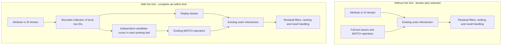

# MatchByCandidates search hint

`MatchByCandidates` is an opt-in execution hint for queries that combine
`MATCH()` with a selective attribute or document-ID predicate. It asks the
engine to identify candidate rows first and restrict full-text posting work to
those rows. Matching, positions, ranking, residual filters, sorting, and result
limits still use the normal search machinery. Unhinted queries retain their
existing execution path. The change requires no reindexing or on-disk format
change.

The implementation was developed from upstream commit
`df6fc413f8ba800e26272dcf57dcdd5469bc92c6` and committed as
`ff5cb3c33eeddb581a537c5116ceec202fa34d41` on
`feature/MatchByCandidates`. This document describes that feature commit;
local RPM packaging and version-stamping edits are separate.

## Problem

A query can combine a selective attribute filter with a costly full-text
condition. For example, a large `documents` table might have millions of rows
containing common words while `group_id = 42` selects only a few dozen. The
existing engine can use a secondary index for `group_id` and intersect it
with the full-text result, yet full-text posting leaves may still decode many
noncandidate documents and visit their hits before that outer intersection
rejects them. The cost model may also choose a full-text-first plan despite an
available candidate producer. A small `LIMIT` does not solve this: the first
few attribute candidates might fail `MATCH()`, while a later one matches.

The hint makes a complete set of attribute/ID candidate row IDs available to
the posting leaves. A leaf can seek toward those IDs on disk and avoid
noncandidate field, hit, and positional work. The existing MATCH tree still
decides which candidate documents satisfy the full-text expression. The
candidate list can be a superset of final results, but it must never omit a
row that could pass the complete `WHERE` clause; that requirement drives the
fallback and filter-tree rules below.

## SQL and intended use

Place the argument-free hint in a SQL hint comment on the `SELECT` statement:

```sql
SELECT id, title
FROM documents
WHERE MATCH('"alpha beta gamma"~3')
  AND group_id = 42
OPTION ranker=none /*+ MatchByCandidates */;

SELECT id FROM documents
WHERE id IN (101, 205, 309) AND MATCH('alpha beta')
/*+ MatchByCandidates DocidIndex(id) */;
```

The second example combines it with an existing access-path hint. There is no
`MatchByCandidates(...)` syntax; the row limit is a daemon setting. The hint
is useful when an indexed predicate or ID lookup yields few rows while common
terms, a conjunction, or a positional `MATCH()` expression would otherwise
visit many postings. Benchmark both forms for the actual query and data.
Broad predicates can be slower because candidate collection is attempted
before ordinary matching. A query without `MATCH()` has no posting work to
restrict. Joins and KNN queries retain their normal execution path.

## Execution architecture

### Execution without the hint

On disk, `CSphIndex_VLN::SelectIteratorsFT` compares the estimated cost of
full-text matching followed by filters with the cost of intersecting full-text
matches and a filter iterator. `SelectIterators` can propose document-ID
lookup, secondary-index, or columnar-analyzer access. If the full-text-first
plan wins, the normal filters check the matches produced by the ranker.

When a filter iterator is selected, `ParsedMultiQuery` attaches it through
`EXTRA_SET_ITERATOR`. The existing ranker handler in
[`src/sphinxsearch.cpp`](../src/sphinxsearch.cpp) calls
`CreatePseudoFTNode`, whose implementation is:

```cpp
return std::make_unique<ExtAndRightHits_c> ( new ExtIterator_c(pIterator), pNode );
```

`ExtIterator_c` exposes candidate row IDs as document blocks. The outer AND
intersects those blocks with the original full-text tree (`pNode`), taking
hits from the full-text side. This machinery already exists without the
patch; the hint reuses it. Existing tree nodes also propagate row-ID hints,
so ordinary execution is not necessarily an exhaustive full-text scan.
However, producing the next full-text block can still decode postings and
evaluate positional conditions for rows between the attribute candidates.
The outer intersection has less information than a leaf with the complete
candidate set, especially when several common words must be combined.

Unhinted RAM execution resets the ranker for each segment, reads its postings,
and applies the normal filter chain. It does not perform the new preliminary
live-row scan described below.

### What the hint changes

There are two coordinated changes: retain an available disk candidate plan,
and pass its complete row-ID set down into the full-text leaves. The diagram
shows the disk iterator case; arrows indicate data flow, not separate threads.



`SelectIteratorsFT` still uses the existing filter planner and access-path
hints. If that planner produces a usable iterator, `MatchByCandidates`
bypasses the final cost comparison that could discard it in favor of
full-text-first execution. It neither creates an index nor forces all indexed
predicates into the plan. `ParsedMultiQuery` then collects the combined
iterator, profiles that collection, and attaches its replay wrapper through
the same `EXTRA_SET_ITERATOR` interface.

For example, suppose the local candidates are `{5, 1000, 9000}` and the query
contains `MATCH('"alpha beta"')`. Each term leaf tries to return postings only
for those rows. The existing phrase node still checks whether `alpha` and
`beta` occur consecutively in each retained document. A document containing
both words in the wrong order still fails. Fields, positions, ranker factors,
dead-row checks, residual predicates, sorters, and final expressions keep
their normal meaning; `HIGHLIGHT()` is not used to approximate matching.

### Candidate state, ownership, and activation

`MatchCandidates_t` owns a sorted, unique vector of chunk-local `RowID_t`
values supplied by the existing disk iterator or the RAM live-row scan. It
also holds the sampled limit, activation and sticky-abort flags, deadline,
and a borrowed warning destination. `ISphQwordSetup::m_pMatchCandidates`
passes a borrowed pointer into the matching tree. It is null on the ordinary
path. Leaves can bind to the state before collection, but restrict postings
only after `m_bActive` becomes true.

The central invariant is **every row that could satisfy the complete query
must be in the candidate set**. Extra candidates are safe because the original
matching and filtering machinery rejects them. An incomplete candidate set
would cause false negatives and must never activate.

| Collection outcome | Candidate restriction | Subsequent execution |
| --- | --- | --- |
| Complete, zero rows | Active | No candidate can match. |
| Complete, at most the limit | Active | Leaves intersect their postings with the complete set. |
| More than the limit | Inactive | Continue matching without leaf restriction; disk replays consumed rows. |
| Timeout, cancellation, or shutdown | Aborted | Stop interrupted work and mark totals approximate; never treat a prefix as an exact set. |
| No safe producer | Inactive | Keep ordinary matching and report the applicable fallback reason. |

On disk the state is local to `ParsedMultiQuery` and is declared before the
term setup and ranker, so it outlives their borrowed references. The replay
wrapper owns the original iterator and borrows the state. On RAM,
`DoFullTextSearch` owns one state within its search coroutine and reuses its
storage across segments. A scope-exit guard restores the previous setup
pointer on all exits. `Reset` rewinds leaf cursors whenever the segment
changes. A row ID belongs only to its disk chunk or RAM segment; external
document IDs are resolved independently in each local row-ID space.

### Disk collection and lossless fallback

`BufferMatchCandidates` constructs `MatchCandidateReplay_c`. The constructor
copies whole sorted source blocks while they fit the configured limit. It
sets `m_bActive` only when the source reports exhaustion. Thus exactly the
limit is allowed, but merely filling the buffer is insufficient: collection
must establish that no further rows exist.

If the next block does not fit, the wrapper retains a borrowed view of that
entire block rather than copying a partial block or discarding its remainder.
It subsequently exposes, in order:

1. The copied prefix, in blocks of at most 512 rows.
2. The pending block owned by the source.
3. The untouched remainder of the source.

`HintRowID` lower-bounds the prefix and pending block before forwarding a
hint to the source. The source must not advance while its pending block is
still needed, because that would invalidate the borrowed storage. The wrapper
also forwards existing iterator descriptions, counters, and cutoff methods.
It serves the original outer intersection both when restriction activates and
when collection overflows.

`ParsedMultiQuery` passes `-1` as the producer cutoff when candidate collection
is enabled (`bUseCandidates ? -1 : iCutoff`). Result `LIMIT`, `max_matches`,
and `cutoff` cannot truncate the candidate set: for example, the first two
candidates can fail a phrase while the third is the first valid result.
Final result handling retains its normal limits.

Overflow falls back to unrestricted posting leaves with the already-selected
iterator plan. It does **not** rerun the planner to recover the exact plan an
unhinted query would have chosen. Collection, the retained plan, and the
producer's disabled cutoff can therefore add cost even though results remain
correct.

### Posting cursors and disk I/O

`MatchCandidateCursor_t::{Hint, Next}` maintains a separate candidate offset
and current posting for each leaf. `Next` advances toward a candidate, returns
only an equal row ID, and leaves the word positioned so existing hit-reading
code can run. If a posting overshoots a missing candidate, it is retained for
the next candidate. For candidates `{1, 4, 5}` and postings `{1, 5}`, advancing
toward `4` must reuse posting `5` rather than consume it again and lose a
match. One term's progress cannot advance another term's candidate offset.

`ExtTerm_T` applies the restriction before field and hit processing. The
optimized `ExtMultiAnd_T` bypasses ordinary term nodes, so it receives a cursor
for each word as well, including its field-rejection advance loop. Active
`HintRowID` handling advances the candidate cursor instead of independently
advancing the word a second time.

Seekable disk words use `ISphQword::AdvanceTo`, backed by existing skip
checkpoints; they may still decode intervening rows within a checkpoint block.
This is not a new direct lookup of arbitrary word/document pairs.
`DiskIndexQword_c::HintRowID` can switch an active, file-backed forward seek
to the reader's existing 1,024-byte buffer and use a small read-ahead hint.
This avoids fetching large amounts of posting data around sparse candidates.
Mapped readers, unhinted reads, and inactive fallback readers retain their
normal policy. Checkpoint bases, inline-hit handling, and posting/hitlist
formats are unchanged.

### RAM collection and filter safety

RAM has no equivalent disk posting checkpoints. Under the existing segment
lock, `PerformFullTextSearch` binds the segment's attributes, blob pool, and
columnar storage, then calls `CollectRamMatchCandidates` before ranker
`Reset`. The collector scans `RtLiveRows_c`, evaluates safe native predicates,
and records matching local row IDs. Only a complete scan within the limit
activates the set. Overflow needs no replay because collection has consumed
attributes, not postings. Matching still advances RAM postings sequentially,
but can avoid noncandidate hit and positional work.

The collector reuses `TransformFilters` and `sphCreateFilters`, preserving
normal native conversions and collation. Expression-backed attributes,
expression filters, optional predicates, and user-variable filters are not
safe native prefilters here. For a flat conjunction, omitting such a predicate
produces a safe superset: `native AND residual` implies `native`. With an
explicit filter tree, any unsafe predicate causes `unsafe_filter_tree`
fallback. For example, retaining only `group_id=42` from
`group_id=42 OR expression_condition` could wrongly remove the other branch.
A tree whose predicates are all safe can be built intact. No usable native
predicates gives `no_native_prefilter`; unsupported transformation, dynamic
schema, filter construction, or a weight filter gives `prefilter_unavailable`.

User variables require particular care. The original filter already holds
its bound value set; rebuilding that predicate could observe a concurrent
`SET GLOBAL @variable` and intersect two different snapshots. The RAM
collector excludes it, leaving the original binding authoritative. A safe
flat-AND predicate may still narrow the set, but an unsafe OR tree falls back.

### MATCH operators, wildcard payloads, and ranking

The hint does not introduce a new MATCH parser or a phrase-only evaluator.
Existing operators consume the restricted document/hit streams and retain
their semantics, including negative conditions. Pure-negative queries still
require the existing `not_terms_only_allowed` option. Eligibility depends on
the candidate producer and query context, rather than a new list of accepted
MATCH strings. This does not imply equal speedups or exhaustive regression
coverage of every syntax/operator combination.

Wildcard and other payload expansions can use `ExtPayloadBase_T` rather than
ordinary term leaves. Its constructor retains `PopulateCache(tSetup, true)`:
the initial corpus-statistics/cache pass is unrestricted so keyword statistics
and ranking do not become statistics of the candidate subset. Later
`FilterCandidates` intersects the sorted cache with candidates before use.
During RAM resets, `FetchHits(..., false)` checks candidate membership before
`SeekHitlist`. Expansions are not globally row-sorted during collection, so
this membership check uses binary search rather than one forward cursor.

An active empty set returns before that binary search; a reused vector may
retain allocation even when its length is zero. Ranker reset happens after
RAM collection so both payload caches and ordinary cursors see the current
segment's set. These measures preserve results and weights, but the initial
corpus pass and cache allocation can still dominate wildcard queries.

### Interruption and integration boundaries

`MatchCandidates_t::Check` uses the query deadline, server shutdown flag, and
killed-session state. It sets a sticky abort and warning, and cooperatively
reschedules when the coroutine exhausts its time slice. Checks occur during
collection and cursor work, with periodic checks during long sequential
posting, live-row, and hit loops. Once aborted, a cursor does not consume
another posting. Completion also handles a warning raised first by an
existing leaf's timeout logic, marking interrupted totals approximate.
This follows existing partial-result behavior; cancellation is cooperative,
not a hard real-time deadline.

KNN and joined queries deliberately exclude candidate restriction and report
`knn_or_join` when that execution path is reached. Full scans without MATCH
report `no_match`; disk searches with no selected producer report
`no_iterator`. These are supported fallback cases, not optimized join or KNN
implementations. An early reject can perform no collection at all. Distributed
agents run the same local logic independently, as described below.

## Limit, memory, and concurrency

The per-daemon default is 65,536 candidate rows per disk chunk or RAM segment;
accepted values are 1 through 524,288:

```ini
searchd {
    match_by_candidates_limit = 100000
}
```

```sql
SET GLOBAL match_by_candidates_limit = 100000;
SHOW GLOBAL VARIABLES LIKE 'match_by_candidates_limit';
```

Startup and `SET GLOBAL` reject out-of-range values. Each search context samples
the atomic setting once, so changing it cannot resize that context's limit
mid-collection. This is a context-level snapshot, not a coordinated snapshot
across all chunks and remote agents of a distributed query. Runtime changes
do not survive a restart; each remote daemon has its own setting. Different
limits can change activation and latency without changing correct results.

The buffer stores sorted, chunk-local `RowID_t` values, not external document
IDs or full rows. It grows only as candidates arrive. At four bytes per ID,
the default copied-row bound is 256 KiB and the maximum is 2 MiB per context;
other iterator, ranker, and read buffers add to total query memory. Disk
chunks searched in parallel own separate buffers, so their peaks add. RAM
segments reuse one buffer within a context. The vector is destroyed at the
end of the query context; an allocator may retain freed pages in process RSS.

## SQL integration, agents, and observability

The SQL lexer recognizes `MatchByCandidates` only inside `/*+ ... */`; the
same word remains an ordinary identifier elsewhere. Quoted JSON subkeys and
comments inside a hint restore the hint lexer state. Generated FACET queries
inherit the flag, SQL query logs reproduce it, and a batch cannot share one
matching execution between hinted and unhinted queries. Hinted disk queries
bypass the query cache before ranker construction, so diagnostics reflect work
that actually ran.

For distributed search, the patched coordinator sends the hint in existing
query flag bit 18. A patched agent executes it and returns opt-in iterator
statistics in agent reply stat-mask bit 8. An unpatched agent whose protocol
otherwise accepts the coordinator's request ignores the unknown bit, returns
ordinary correct matches, and is reported as
`MatchByCandidatesFallback(agent_not_acknowledged)`. A coordinator without
this patch cannot parse and forward the hint; ordinary distributed queries
still use their existing behavior. No new standalone search command version
or disk format was added. These compatibility paths do not replace testing
against every historical daemon release.

After a hinted query, `SHOW META LIKE 'index'` reports, for example:

```text
@match:MatchByCandidates (100%), group_id:SecondaryIndex (100%)
@match:MatchByCandidatesFallback(candidate_limit) (100%), group_id:SecondaryIndex (100%)
```

`@match` percentages describe the fraction of reported matching contexts
that used each active/fallback path. They are neither selectivity nor elapsed
time. The renderer uses an `@match` denominator separate from the existing
index-stat denominator; this prevents multi-chunk results such as `900%`
while leaving older secondary-index entries formatted as before. A disk ID
lookup or columnar analyzer can supply candidates without a secondary-index
entry. Other fallback reasons include `no_iterator`, `no_match`,
`knn_or_join`, `no_native_prefilter`, `unsafe_filter_tree`,
`prefilter_unavailable`, `interrupted`, and `no_work`.

With `SET profiling=1`, `SHOW PROFILE` includes `candidate_collect` for disk
materialization and RAM scans, including attempts that reach the limit and
fall back. It does not represent all candidate matching time; existing
`read_docs`, `read_hits`, and `get_docs` states still account for matching
work. With profiling off, candidate collection does not take timestamps or
record profile state transitions. `SHOW PLAN` renders the transformed match
tree; use `SHOW META` to see whether candidate restriction actually activated
for each search context.

## Performance evidence

The controlled primary fixture had 100,000 documents in one disk chunk, six
attribute candidates, and one true phrase/proximity match. It used common
alphabet terms, numeric highlighting, `ranker=none`, one thread, identical
result options, disabled query cache, and separate copies of the same data
for the saved original and patched binaries. Times below are warm medians
after three warmups, from 21 measured runs:

| Build and execution | Median time |
| --- | ---: |
| Saved unmodified build | 14.313 ms |
| Patched build, no hint | 13.503 ms |
| Patched build, hint | 0.785 ms |

The hint was 17.2x faster than patched unhinted and 18.2x faster than the
saved build in this fixture. Separate ID-predicate measurements (15 warm
runs) gave 13.563 ms unhinted versus 0.769 ms hinted for all six IDs; one
known matching ID gave 1.507 ms versus 0.550 ms. The distinction matters:
one ID is much easier than a complete candidate list.

| Other fixture | Unhinted median | Hinted median | Ratio |
| --- | ---: | ---: | ---: |
| RAM, 25,000 rows | 16.189 ms | 0.799 ms | 20.3x |
| Wildcard, 12,000 rows | 6.606 ms | 3.280 ms | 2.0x |

Instrumented work counts on the disk reproduction fell from 405,612 to
2,720 decoded posting-row deltas and from 28,002 to 3 hitlist seeks. The
small-buffer tuning reduced data returned from the `.spd` file from about
7.86 MB in the first hinted prototype to about 110 KB in the tuned hinted
version. Those are call/reader measurements, not physical disk-page reads
or latency percentages, and instrumentation was excluded from wall-time runs.

One additional, non-repeated query on a larger local dataset returned the
same two rows with no warnings in about 24 ms hinted versus 3.15 s unhinted
(roughly 129x). It used a proximity query with four string-filter values,
`ranker=none`, `threads=1`, and `max_matches=10000`. This observation is
workload-specific and is not a controlled benchmark.

These timings were recorded during patch development before the final parser,
profiling, and metadata review fixes. The final feature commit was validated
for correctness, but this benchmark set was not rerun against that exact
commit.

The bound limits copied candidate memory, **not** collection cost. An
over-limit predicate pays for the attempted collection and then runs the
normal path; no general speedup or fixed fallback penalty is claimed.
RAM still scans live rows to collect candidates, and wildcard corpus setup
can dominate a hinted query. The research measurement artifacts are outside
this repository; the numbers here describe their setup and limits rather
than a maintained performance regression test.

## Validation and review boundaries

The feature extends the existing unit-test source
[`src/gtests/gtests_rtstuff.cpp`](../src/gtests/gtests_rtstuff.cpp) with
cursor, replay, exact/overflow bound, limit snapshot, parser, cancellation,
timeout, old-agent metadata, RAM user-variable, and RAM profiling cases. All
13 focused tests passed in the recorded focused test run. The existing SQL
fixture [`test/test_461/test.xml`](../test/test_461/test.xml) and its generated
`model.bin` cover RAM and disk chunks, ID and secondary-index paths, ranking
and weights, wildcard/reset behavior, limit fallback, nested agents, and
multi-index metadata. Its `rt_461`, `rtidx_461`, and `col_461` variants passed
in the recorded standard test run.

### Edge cases and regression evidence

The table maps failure modes to safeguards and maintained checks. Unit names
without a prefix belong to `MatchCandidates.*` in
[`gtests_rtstuff.cpp`](../src/gtests/gtests_rtstuff.cpp). SQL cases refer to
[`test_461/test.xml`](../test/test_461/test.xml), whose comments identify each
scenario. These checks establish specific behavior; they are not a claim
that every storage layout, operator, or concurrent schedule was tested.

| Edge case / failure avoided | Handling and maintained evidence |
| --- | --- |
| Empty set mistaken for inactive state; leaves bound before collection | Activation is separate from vector length. `EmptyAndLateActivation` checks late activation, empty results, and reset; `ReplayAtAndAboveLimit` includes an empty producer. |
| Exact limit rejected, or overflow silently truncating matches | Activation requires exhaustion. `ReplayAtAndAboveLimit` checks 65,536, 65,537, and 100,000 rows; `ConfiguredLimitAndSnapshot` checks the configured bound, 524,288 and one above, complete replay, allocation bound, and setting validation. SQL compares 257 candidates with limits 256 and 257 on both RAM and disk. |
| Hinting past a copied prefix loses the overflow block | Replay preserves source-owned pending storage and order. `ReplayHintAcrossOverflowBlock` verifies every remaining row after a hint crossing the prefix. |
| Missing candidate consumes the next valid posting; one term advances another | Each cursor retains its overshoot and has an independent offset. `ReuseOvershootingRamPosting` and `IndependentCursorsAndHints` exercise both failures. |
| Filtering happens after expensive hit reads | `RestrictBeforeReadingHits` checks actual hitlist seeks and verifies that only candidate rows reach them, including candidates within a leaf batch. |
| Small result cutoff omits a later true match | SQL uses `LIMIT 1`, `max_matches=1`, and `cutoff=1` with two phrase-negative candidates before the matching one. Candidate collection remains complete. |
| Duplicate, unordered, missing, zero, or 64-bit external IDs | Existing ID translation supplies local row IDs. SQL covers equality and IN, forced document lookup and secondary index, missing IDs, and IDs above 32 bits and at the signed 64-bit maximum. |
| Candidate passes indexed predicates but fails MATCH or a residual expression | Original matching and residual filters remain active. SQL covers phrase-negative rows, multiple secondary indexes, a deliberately unindexed predicate, a computed expression, empty intersections, and pure-negative matching. |
| Deleted/replaced disk rows reappear, or row IDs leak between chunks | Normal visibility checks remain in force; candidate state belongs to the current chunk/segment. SQL deletes and replaces IDs, compares mixed RAM/disk results, flushes again, and repeats the lookup. |
| RAM user-variable rebinding changes the query's value snapshot | `RT.MatchCandidatesUservarSnapshot` deliberately returns different values on a second binding and asserts there is only one, for standalone, AND, and OR shapes. SQL also checks the resulting active/fallback diagnostics. |
| Checkpoint seeks corrupt positions or skip a batch boundary | SQL probes either side of checkpoints with inline and multiple hits, compares weights, consumes multiple leaf batches, and repeats with file-backed and mmap readers. |
| Wildcard restriction changes weights or reuses stale segment candidates | SQL compares wildcard results on disk and RAM, checks disk weights, and exercises segment reset to an empty candidate set after nonempty work. The initial statistics pass remains unrestricted. |
| Cancellation continues consuming postings or presents an exact total | `CancellationDoesNotConsumeAnotherPosting` verifies sticky abort stops consumption; `TimeoutAndSessionCancellation` checks timeout/killed warnings. Approximate-total propagation and shutdown handling are implemented at the execution boundary; these unit cases do not simulate every concurrent interruption point. |
| Lexer state loses a hint after a quoted JSON key/comment; FACET loses the flag | `HintGrammarAndFacets` checks combinations, argument rejection, ordinary identifiers, and FACET inheritance; SQL covers JSON subkeys and embedded comments. |
| Nested agents duplicate usage counts or multiple chunks show 900% | `NestedAgentDescriptions` tests coalescing active/fallback metadata. SQL exercises nested patched agents and multi-index/chunk output, with old secondary-index entries preserved. The unit test simulates unacknowledged-agent metadata; it is not a real old-binary protocol test. |
| Profiling adds collection timing to unhinted execution or runs when disabled | `RT.MatchCandidatesRamProfileCollection` checks hinted/profiled, unhinted/profiled, and hinted/unprofiled cases. Both collectors use the same nullable scoped profiler; this focused runtime test covers the RAM path. |

Query-cache bypass, mixed hinted/unhinted batch isolation, borrowed-pointer
cleanup, and KNN/join exclusions are explicit integration safeguards in the
code. The tests above should not be interpreted as dedicated end-to-end
coverage of every one of those branches. Historical research exercised
same-base original/patched agent combinations; there is no maintained fixture
here that runs every older daemon release against this patch. Likewise, the
memory test checks allocation and limit snapshots, not concurrent-query peak
RSS or an out-of-memory guarantee.

Important review boundaries remain: checkpoint/reader behavior on other
historical file layouts, concurrent cancellation timing, unusual third-party
plugins, and old/new agent combinations beyond the versions exercised by the
research. The patch also does not remove the existing wildcard statistics
pass or guarantee that an available candidate plan is cheapest for every
selectivity, cutoff, or thread count.

## File-by-file changes

The feature commit changes existing files only. The main entry points and
their reasons are listed below.

### SQL and query state

**[`src/sphinx.h`](../src/sphinx.h).** `CSphQuery::m_bMatchByCandidates`
stores the opt-in request and defaults to `false`. Planning, local execution,
FACETs, and agent serialization read the same flag; the default leaves
unhinted queries on their previous path.

**[`src/sphinxql.l`](../src/sphinxql.l).** The lexer enters an inclusive
`HINT` state at `/*+` and recognizes `MATCHBYCANDIDATES` only there. The
start-condition stack restores that state after a backtick-quoted JSON subkey
or an embedded comment. Without the restoration, a second hint after such a
subkey/comment would be parsed as an ordinary identifier. Outside hints,
`MatchByCandidates` remains a usable identifier or alias.

**[`src/sphinxql.y`](../src/sphinxql.y).** `hint_item` gains
`TOK_HINT_MATCH_BY_CANDIDATES` and calls the parser setter. The production has
no argument list, so `MatchByCandidates()` and `MatchByCandidates(100000)`
are rejected; it can appear beside `SecondaryIndex(...)` or
`DocidIndex(...)` in the same comment.

**[`src/searchdsql.cpp`](../src/searchdsql.cpp).**
`SqlParser_c::SetMatchByCandidates` sets the flag on the current parsed
query. `SetupFacets` copies it to generated facet queries so a FACET does not
silently use a different execution request from its parent SELECT.

**[`src/daemon/query_log.cpp`](../src/daemon/query_log.cpp).**
`FormatIndexHints` emits `MatchByCandidates` even if there are no ordinary
index hints. Logged SQL then reproduces the hinted execution when replayed.

### Candidate state and matching engine

**[`src/sphinxsearch.h`](../src/sphinxsearch.h).** `ISphQwordSetup` gains a
nullable borrowed pointer to candidate state. `MatchCandidates_t` holds the
sorted local row IDs, sampled row limit, activation/abort flags, deadline, and
warning destination. `MatchCandidateCursor_t` declares each posting leaf's
independent candidate and posting positions. The file also declares the
bounded buffer, limit accessors, and diagnostic helper. These contracts keep
candidate ownership local to a search context and forbid activation of a
partial set.

**[`src/searchnode.cpp`](../src/searchnode.cpp).** This file contains the
shared mechanics:

- `MatchCandidates_t::Check` handles deadline, shutdown, and killed-session
  interruption during new collection and cursor loops. `GetMatchCandidatesLimit`
  and `SetMatchCandidatesLimit` read and validate the atomic daemon setting.
- `MatchCandidateCursor_t::{Reset, Hint, Next}` intersects a leaf's posting
  stream with complete candidates. Disk words use `AdvanceTo`; RAM words
  decode sequentially. Each cursor keeps an overshooting posting for the
  next candidate, avoiding skipped matches.
- `ExtTerm_T::{Init, Reset, GetDocsChunk, HintRowID}` applies the cursor before
  field and hit work. `ExtMultiAnd_T::{Advance, Reset}` gives each word in the
  optimized conjunction path its own cursor; that path bypasses `ExtTerm_T`.
- `MatchCandidateReplay_c` and `BufferMatchCandidates` collect disk rows only
  up to the limit. On overflow, `GetNextRowIdBlock` and `HintRowID` replay the
  copied prefix, pending source block, and untouched tail in order. The
  original outer iterator therefore remains complete on fallback.
- `ExtPayloadBase_T::{FetchHits, Reset, FilterCandidates}` and
  `ExtPayload_T::GetDocsChunk` restrict wildcard/payload caches after the
  unrestricted corpus-statistics pass. Reset-time RAM work avoids
  noncandidate hit seeks; an empty active set avoids an invalid range when a
  reused vector still owns storage. `DescribeMatchCandidates` coalesces
  active and fallback descriptions for `SHOW META`.

**[`src/sphinx.cpp`](../src/sphinx.cpp).** Disk search changes are at five
entry points:

- `CSphIndex_VLN::SelectIteratorsFT` retains an available ID, secondary-index,
  or analyzer producer when the hint is set, even if the usual full-text cost
  comparison would choose otherwise. KNN and joins are excluded.
- `CSphIndex_VLN::ParsedMultiQuery` creates query-local candidate state,
  disables query-cache reuse before ranker creation, and calls
  `SpawnIterators` without the result cutoff. It buffers the producer before
  attaching the normal outer intersection, profiles collection, records
  active/fallback metadata, and marks interrupted totals approximate.
- `DiskIndexQwordSetup_c::QwordSpawn` passes the borrowed state and reader
  factory to disk words. `DiskIndexQword_c::HintRowID` uses a small buffer for
  forward checkpoint seeks only after activation; unhinted and overflow
  paths retain normal read-ahead. `CSphIndex_VLN::MultiScan` reports
  `no_match` when a hinted query takes the full-scan path.

**[`src/sphinxrt.cpp`](../src/sphinxrt.cpp).** RAM search uses a different
candidate producer:

- `CollectRamMatchCandidates` selects safe native predicates, reuses normal
  filter transformation/building, and scans live rows under the segment lock.
  It skips user variables to preserve the original binding, rejects unsafe
  filter trees, and activates only after a complete scan within the bound.
- `DoFullTextSearch` owns the state for the search context, samples the daemon
  limit, selects sequential posting mode, and restores the borrowed setup
  pointer on exit. `PerformFullTextSearch` binds each segment's attribute,
  blob, and columnar storage, collects candidates before ranker `Reset`, then
  records collection time and the segment's active/fallback reason.
- `RtIndex_c::MultiQuery` reports `no_match` on hinted full scans.
  `DoFullTextSearch` also marks timed-out or cancelled hinted results
  approximate, including cases where an existing posting leaf detects the
  interruption first.

### Settings and diagnostics

**[`src/queryprofile.h`](../src/queryprofile.h).** `SPH_QUERY_STATES` gains
`CANDIDATE_COLLECT`, rendered as `candidate_collect` by the existing
`SHOW PROFILE` code. Disk materialization and RAM scans use scoped switches
to this state; the scope does no timing work when profiling is off.

**[`src/sphinxutils.cpp`](../src/sphinxutils.cpp).** The `g_dKeysSearchd`
registry accepts `match_by_candidates_limit` in a `searchd` configuration
section. Registration is required before startup validation can use the
setting.

**[`src/searchd.cpp`](../src/searchd.cpp).** `ConfigureSearchd` validates
the configured limit at startup; `HandleSetGlobal` applies runtime changes;
`HandleMysqlShowVariables` exposes the current value. All use the same
validated setter. `BuildMeta` sums `@match` usage counts for its own
percentage denominator while leaving the old denominator for secondary-index
entries. That makes multi-chunk `@match` percentages meaningful without
changing established index-stat output.

### Distributed execution

**[`src/daemon/api_search.cpp`](../src/daemon/api_search.cpp).**
`SearchRequestBuilder_c::SendQuery` writes flag bit 18;
`ParseSearchQuery` restores it on a compatible agent. `SendResult` adds
stat-mask bit 8 and iterator descriptions only for a hinted agent query, so
ordinary replies to older masters keep their original layout.
`SearchReplyParser_c::ParseReply` reads those descriptions with a bounded
count and distinguishes an acknowledged but empty search (`no_work`) from an
agent that did not acknowledge the hint.

**[`src/daemon/search_handler.cpp`](../src/daemon/search_handler.cpp).**
`CheckMultiQuery` prevents shared execution between hinted and unhinted
queries. `SubmitSuccess` copies diagnostics from a shared local ranker to
each hinted result. `RunSubset` merges remote iterator statistics and uses
`DescribeMatchCandidates` to coalesce `agent_not_acknowledged` fallbacks
from compatible unpatched agents, including nested distributed searches.

### Maintained tests

**[`src/gtests/gtests_rtstuff.cpp`](../src/gtests/gtests_rtstuff.cpp).** The
`MatchCandidates.*` cases directly exercise cursor overshoot and independent
term progress, suppression of noncandidate hit seeks, exact-bound and
overflow replay, limit snapshots, parser/FACET syntax, old-agent metadata,
and cancellation. `RT.MatchCandidatesUservarSnapshot` checks that a changing
user variable cannot silently remove a RAM result;
`RT.MatchCandidatesRamProfileCollection` checks hinted, unhinted, and
unprofiled timing behavior.

**[`test/test_461/test.xml`](../test/test_461/test.xml).** The existing
secondary-index SQL fixture gains paired hinted/unhinted queries for ID
lookup, multiple indexed filters, phrase and wildcard matching, weights,
deletes/replacements, RAM and disk chunks, cutoff independence, and
limit-triggered fallback. It also exercises nested agents and verifies that
multi-index `SHOW META` keeps `@match` at 100% without changing the older
secondary-index entries.

**[`test/test_461/model.bin`](../test/test_461/model.bin).** The existing
binary model was regenerated with expected rows, weights, and diagnostics for
the added SQL cases. The normal `rt_461`, `rtidx_461`, and `col_461` variants
use it; there is no separate test framework for this feature.
